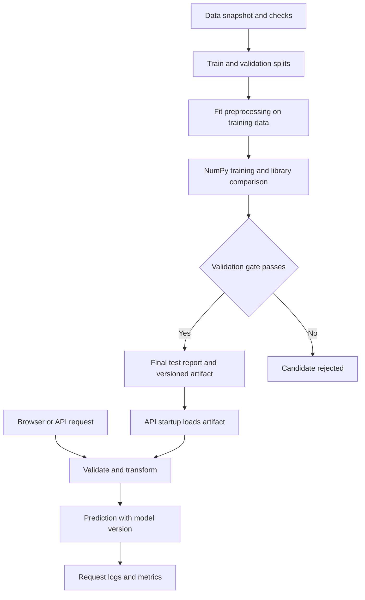

# Architecture

Two flows share a versioned artifact, not a running training process.

| Module | Responsibility | What you should explain |
|---|---|---|
| `preprocessing.py` | Learn medians, clipping bounds, scaling and categories | Why fitting it on all records would leak evaluation information |
| `scratch.py` | Optimize a regularized squared-error objective | Every matrix multiplication and gradient update |
| `training.py` | Audit, split, compare, evaluate and release | The difference between validation decisions and final test reporting |
| `artifact.py` | Load JSON state and reproduce prediction | Why model weights and preprocessing belong together |
| `api.py` | Validate input and serve a loaded model | How a POST body becomes a prediction without retraining |
| `drift.py` | Compare incoming distributions with a training reference | Why a distribution shift is not proof of reduced accuracy |

## Model mathematics

After preprocessing, a batch has matrix X of shape `(number_of_records, number_of_features)`.
The weights form a vector w; the intercept b is a scalar. For training, targets
are divided by 100,000 to keep the numerical scale manageable.

$$\hat{y} = Xw + b$$

$$L = \frac{1}{n}\|Xw+b-y\|^2 + \lambda\|w\|^2$$

$$\nabla_w L = \frac{2}{n}X^T(Xw+b-y) + 2\lambda w$$

$$\frac{\partial L}{\partial b} = \frac{2}{n}\sum_i(\hat{y}_i-y_i)$$

Weights and bias are updated by subtracting the learning rate times their gradients.
The intercept is not regularized. The penalty discourages excessively large weights.
To compare fairly with sklearn Ridge's sum-error objective, its alpha is `n * lambda`.

## Artifact contents

The active file is `artifacts/model.json`. Releases are retained under
`artifacts/releases/<model_version>/`. A state digest checks accidental corruption;
it is not a cryptographic signature establishing who produced an artifact.

Each release records parameters, preprocessing, training configuration, dataset
checksum, source checksum, split checksums, runtime versions, audit and evaluation.
There is no pickle execution or library-specific estimator object in serving.

Floating-point training can differ at the last decimal places across hardware,
even with the same seed and dependency versions. This can produce a different
content hash without a meaningful prediction change. CI trains into a separate
candidate directory and builds its container from the reviewed, checked-in
artifact. The HTTP smoke test checks the exact expected model version.

## Operations scope

One process loads one model. Metrics are process-local and reset when it restarts;
scrape them externally for durable history. Structured logs contain request IDs,
status and timing, not request feature values or API keys. Input drift is assessed
by an explicit batch job. Actual model-performance monitoring requires later labels.
